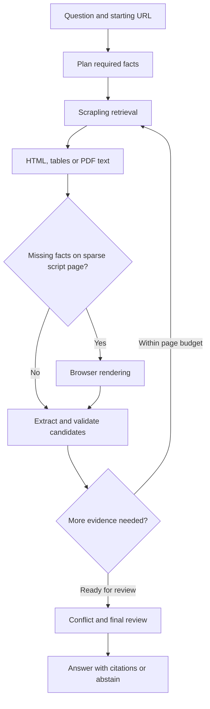

# Match 4 Grounded Web Retrieval on AMD ROCm

A web information retrieval agent that follows links, searches GET forms, reads tables and PDFs, and returns answers with verified source passages. Built for the AMD AI League's Intelligent Web Information Retrieval track.

Inference runs locally through a resident **vLLM** server using **Qwen/Qwen3-4B-Instruct-2507**. Website retrieval uses **Scrapling**. No ChatGPT sign-in or hosted LLM API key is required.

> **Validation status:** Offline application checks pass. Docker, vLLM/ROCm compatibility, GPU memory use and live Qwen accuracy have not yet been validated on the competition GPU. The supplied briefs cover Matches 1–3; Match 4's exact CLI and output contract remain unconfirmed. See [competition readiness](docs/COMPETITION.md).

## Features

- Plans required facts and follows links within the starting origin.
- Uses discovered GET search forms and structured table text.
- Tries static retrieval first, then bounded browser rendering for sparse JavaScript pages.
- Reads direct and linked PDFs with page-number citations.
- Validates quoted passages, reviews semantic support, and abstains when evidence is insufficient.
- Reviews competing grounded claims and explains resolutions or ambiguity.
- Includes 33 local and public-site cases plus offline regression checks.

## Architecture



Python controls parsing, navigation limits and passage matching. The local LLM plans facts, chooses useful routes and reviews meaning. Source text is treated as untrusted data. Grounding confirms that quoted evidence exists; it does not establish a website's truthfulness.

## AMD notebook setup

For Jupyter, copy each fenced cell separately. `!` runs a shell command, `%cd` changes the notebook directory, and Python assignments set environment variables that `!` commands inherit. The example below uses the AMD notebook's `/persistent` directory; use `/workspace` on `rgapi-hackathon-*` sessions.

If you already cloned the repository, skip the clone cell and use `%cd` with your existing folder. The commands below are for a new checkout:

```python
%cd /persistent
!git clone https://github.com/Ahmed-sa3ed/match4-rocm-web-agent.git
%cd /persistent/match4-rocm-web-agent
```

Check the notebook GPU and create a constraint file to preserve the preinstalled ROCm PyTorch:

```python
!python3 -c 'import torch; print(torch.__version__, torch.version.hip, torch.cuda.get_device_name(0)); assert torch.cuda.is_available()'
!python3 -c 'import torch; print("torch==" + torch.__version__)' > constraints-torch.txt
!python3 -m pip install -c constraints-torch.txt -r requirements.txt
```

Run the application checks without a model or browser:

```python
!python3 backend_selfcheck.py
!python3 app_selfcheck.py
!python3 feature_selfcheck.py
!python3 adaptive_selfcheck.py
!python3 conflict_selfcheck.py
!python3 pdf_selfcheck.py
!python3 run_agent_suite.py --dry-run
```

Browser rendering needs a Chromium installation and Ubuntu system libraries. If not already present, `!scrapling install` normally installs them, but it requires network access to Ubuntu APT mirrors. The hosted notebook we tested blocked those mirrors; installing only the browser download may leave missing libraries. Do not interpret the offline browser checks as proof Chromium starts.

On the tested AMD notebook, Chromium needed this setting to start its child processes. Set it in a Python cell before the browser check and before running the agent; notebook `!` commands inherit it:

```python
import os
os.environ["MATCH4_BROWSER_NO_ZYGOTE"] = "1"
```

```python
!python3 browser_livecheck.py
```

The real browser test passed on the AMD notebook on October 27, 2026 with this option. It executes local JavaScript through Scrapling, but does not validate public sites. Other environments can omit the variable. The notebook's Chromium already ran with `--no-sandbox`; the setting adds `--no-zygote` only.

### Local model prerequisite

Full agent tests require a resident vLLM server. The tested Python 3.14.4 / ROCm PyTorch 2.13 notebook does **not** have vLLM. A source checkout dry run failed because vLLM pinned `amd-quark==0.12.post1`, whose published package excludes Python 3.14. The provided `scripts/build_vllm.sh` is an experimental recipe, not a validated install path for this notebook. It must not be run blindly: it has not resolved this dependency conflict or the hosted compiler layout (`ROCM_HOME=/opt/vram-enforcer`). Installing a generic vLLM wheel may replace the notebook's ROCm PyTorch build. See the [official vLLM ROCm installation guide](https://docs.vllm.ai/en/stable/getting_started/installation/gpu/).

Once a compatible local vLLM installation is **actually working** on the same Python environment, verify it:

```python
!python3 -c 'import torch, vllm; assert torch.version.hip; print(torch.__version__, vllm.__version__)'
```

Start the server in a separate Jupyter **Terminal** and leave it running. These are terminal commands, so do not add notebook `!` prefixes:

```bash
cd /persistent/match4-rocm-web-agent
export HF_HOME="$PWD/hf-cache"
export MATCH4_BROWSER_NO_ZYGOTE=1
python3 serve.py
```

Wait for `Local vLLM is ready`, then return to the notebook and run the local model and full suite:

```python
!python3 local_agent.py models
!python3 local_agent.py smoke --model Qwen/Qwen3-4B-Instruct-2507
!python3 run_agent_suite.py --only local --workers 1
!python3 run_agent_suite.py --workers 1
```

The full suite makes public network requests; those sites may change or be blocked by the notebook network. Reports are saved in `test_reports/`. These commands test a running agent only after vLLM is installed and ready. The server uses BF16, a 32,768-token context, up to two sequences, and a 70% GPU memory target. These settings and the competition's final Match 4 contract remain unvalidated.

## Ask a question

In another terminal:

```bash
python3 app.py --url https://www.iana.org/help/example-domains \
  --query "Can example.com be registered?" --query-id example-domains
```

This writes `output/example-domains_output.json`, prints JSON to stdout and logs decisions to stderr. Options include `--output-dir`, `--max-pages` (1–20, default 4) and `--static-only`.

For readable terminal citations:

```bash
python3 local_agent.py ask https://www.iana.org/help/example-domains \
  "Can example.com be registered?" --model Qwen/Qwen3-4B-Instruct-2507
```

Answered results contain `status`, `answer` and `citations`. Each citation records `field`, `value`, `source_url`, `quote` and `support_mode`; PDFs add `page_number`. Conflict reports include competing claims and a resolution reason. Abstentions contain an empty answer and no citations. This is the project's current interface, pending the official Match 4 contract.

## Tests and evaluation

Offline checks need application dependencies, but no running model or GPU:

```bash
python3 backend_selfcheck.py
python3 app_selfcheck.py
python3 feature_selfcheck.py
python3 adaptive_selfcheck.py
python3 conflict_selfcheck.py
python3 pdf_selfcheck.py
python3 run_agent_suite.py --dry-run
```

With vLLM running:

```bash
python3 local_agent.py smoke --model Qwen/Qwen3-4B-Instruct-2507
python3 run_agent_suite.py --only local --workers 1
python3 run_agent_suite.py --workers 1
```

Reports go to `test_reports/`, excluded from Git. Browser cases require a final citation supported by content added through rendering. A failed launch cannot pass merely because static navigation finds the answer. Public websites can change. Previous hosted-model scores are not results for local Qwen.

## Docker packaging

The final image starts from the exact ROCm base in the supplied briefs and keeps the model resident for repeated CLI invocations. Build this on the target AMD environment after validating a vLLM revision:

```bash
export VLLM_REF=YOUR_VALIDATED_VLLM_COMMIT
docker build --build-arg VLLM_REF="$VLLM_REF" -t match4-agent:local .
docker run -d --name match4-agent \
  --device /dev/kfd --device /dev/dri --group-add video --ipc=host \
  -v match4-models:/models match4-agent:local
docker logs -f match4-agent
```

After readiness:

```bash
docker exec match4-agent python3 /app/app.py \
  --url https://www.iana.org/help/example-domains \
  --query "Can example.com be registered?" --query-id example-domains
docker cp match4-agent:/app/output/example-domains_output.json .
```

No public service port is exposed. The build fails if `VLLM_REF` is omitted. Native kernel compilation and the mandated base must be tested together before this can be called a verified competition image.

## Scope and limitations

A starting URL is required; there is no general search-engine discovery. Navigation remains on the starting origin. Browser fallback handles sparse script pages, not arbitrary clicks or dense application shells. PDFs require selectable text; there is no OCR. Page limits do not enforce a whole-query deadline, and multi-step queries may exceed the earlier briefs' 30-second limits. Confirm the Match 4 limits before submission.

## Files

| Files | Purpose |
|---|---|
| `app.py`, `local_agent.py` | File-output and interactive CLIs |
| `serve.py`, `decision.py` | Resident vLLM and local inference |
| `agent.py`, planning and navigation modules | Retrieval control |
| `retrieval*.py`, `forms.py`, `tables.py`, `page_chunks.py` | Scrapling and document parsing |
| `extraction.py`, `evidence.py`, `validation.py`, `text_match.py` | Grounding, conflicts and citations |
| `*_selfcheck.py`, `test_site/` | Offline checks and fixtures |
| `run_agent_suite.py`, `agent_suite.json` | Live and local evaluation |
| `Dockerfile`, `scripts/`, `docs/` | Deployment and readiness |

Credentials, model weights, local environments, downloaded competition documents and generated reports are excluded. Models and dependencies retain their upstream licenses.
