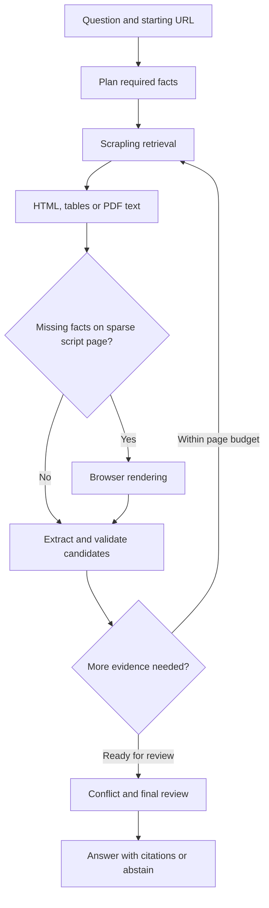

# Match 4 Grounded Web Retrieval on AMD ROCm

A web information retrieval agent that follows links, searches GET forms, reads tables and PDFs, and returns answers with verified source passages. Built for the AMD AI League's Intelligent Web Information Retrieval track.

Inference runs locally through a resident **vLLM** server using **Qwen/Qwen3-4B-Instruct-2507**. Website retrieval uses **Scrapling**. No ChatGPT sign-in or hosted LLM API key is required.

> **Validation status:** Offline application checks pass. Docker, vLLM/ROCm compatibility, GPU memory use and live Qwen accuracy have not yet been validated on the competition GPU. The supplied briefs cover Matches 1–3; Match 4's exact CLI and output contract remain unconfirmed. See [competition readiness](docs/COMPETITION.md).

## Features

- Plans required facts and follows links within the starting origin.
- Uses discovered GET search forms and structured table text.
- Tries static retrieval first, then bounded browser rendering for sparse JavaScript pages.
- Reads direct and linked PDFs with page-number citations.
- Validates quoted passages, reviews semantic support, and abstains when evidence is insufficient.
- Reviews competing grounded claims and explains resolutions or ambiguity.
- Includes 33 local and public-site cases plus offline regression checks.

## Architecture



Python controls parsing, navigation limits and passage matching. The local LLM plans facts, chooses useful routes and reviews meaning. Source text is treated as untrusted data. Grounding confirms that quoted evidence exists; it does not establish a website's truthfulness.

## AMD notebook setup

Use Linux with an AMD GPU and ROCm PyTorch. The original checkpoint used Python 3.14.4, PyTorch `2.13.0+rocm10.0.0`, and an MI300X VF with approximately 47 GiB VRAM.

Clone into persistent storage: `/persistent` for `jupyter-hack-*` sessions, or `/workspace` for `rgapi-hackathon-*` sessions, according to the supplied event guidance. The approximately 25 GB persistent quota includes model and browser caches.

```bash
git clone https://github.com/Ahmed-sa3ed/match4-rocm-web-agent.git
cd match4-rocm-web-agent
python3 -c 'import torch; print(torch.__version__, torch.version.hip); assert torch.cuda.is_available()'
python3 -c 'import torch; print("torch==" + torch.__version__)' > constraints-torch.txt
python3 -m pip install -c constraints-torch.txt -r requirements.txt
scrapling install
```

Install vLLM compatible with the exact Python, PyTorch and ROCm environment. **Do not blindly install a generic vLLM wheel over the notebook's torch build.** The [official vLLM guide](https://docs.vllm.ai/en/stable/getting_started/installation/gpu/) requires a source build when retaining a different PyTorch/ROCm stack.

`scripts/build_vllm.sh` is an unverified source-build recipe that preserves torch through pip constraints. It requires an explicit `VLLM_REF` selected and tested for the target environment, plus that revision's native prerequisites. No compatible revision is claimed yet. If vLLM is already installed, verify it:

```bash
python3 -c 'import torch, vllm; assert torch.version.hip; print(torch.__version__, vllm.__version__)'
```

Start the model once and keep this terminal running:

```bash
export HF_HOME="$PWD/hf-cache"
python3 serve.py
```

Wait for `Local vLLM is ready`. First startup downloads missing model weights. `MODEL_ID` may point to predownloaded weights; the served name remains `Qwen/Qwen3-4B-Instruct-2507`.

The server binds to loopback, uses BF16, a 32,768-token context, up to two sequences and a 70% GPU memory target. These are starting settings for the original MI300X environment, not measured VRAM guarantees or validated Radeon settings.

## Ask a question

In another terminal:

```bash
python3 app.py --url https://www.iana.org/help/example-domains \
  --query "Can example.com be registered?" --query-id example-domains
```

This writes `output/example-domains_output.json`, prints JSON to stdout and logs decisions to stderr. Options include `--output-dir`, `--max-pages` (1–20, default 4) and `--static-only`.

For readable terminal citations:

```bash
python3 local_agent.py ask https://www.iana.org/help/example-domains \
  "Can example.com be registered?" --model Qwen/Qwen3-4B-Instruct-2507
```

Answered results contain `status`, `answer` and `citations`. Each citation records `field`, `value`, `source_url`, `quote` and `support_mode`; PDFs add `page_number`. Conflict reports include competing claims and a resolution reason. Abstentions contain an empty answer and no citations. This is the project's current interface, pending the official Match 4 contract.

## Tests and evaluation

Offline checks need application dependencies, but no running model or GPU:

```bash
python3 backend_selfcheck.py
python3 app_selfcheck.py
python3 feature_selfcheck.py
python3 adaptive_selfcheck.py
python3 conflict_selfcheck.py
python3 pdf_selfcheck.py
python3 run_agent_suite.py --dry-run
```

With vLLM running:

```bash
python3 local_agent.py smoke --model Qwen/Qwen3-4B-Instruct-2507
python3 run_agent_suite.py --only local --workers 1
python3 run_agent_suite.py --workers 1
```

Reports go to `test_reports/`, excluded from Git. Browser cases require a final citation supported by content added through rendering. A failed launch cannot pass merely because static navigation finds the answer. Public websites can change. Previous hosted-model scores are not results for local Qwen.

## Docker packaging

The final image starts from the exact ROCm base in the supplied briefs and keeps the model resident for repeated CLI invocations. Build this on the target AMD environment after validating a vLLM revision:

```bash
export VLLM_REF=YOUR_VALIDATED_VLLM_COMMIT
docker build --build-arg VLLM_REF="$VLLM_REF" -t match4-agent:local .
docker run -d --name match4-agent \
  --device /dev/kfd --device /dev/dri --group-add video --ipc=host \
  -v match4-models:/models match4-agent:local
docker logs -f match4-agent
```

After readiness:

```bash
docker exec match4-agent python3 /app/app.py \
  --url https://www.iana.org/help/example-domains \
  --query "Can example.com be registered?" --query-id example-domains
docker cp match4-agent:/app/output/example-domains_output.json .
```

No public service port is exposed. The build fails if `VLLM_REF` is omitted. Native kernel compilation and the mandated base must be tested together before this can be called a verified competition image.

## Scope and limitations

A starting URL is required; there is no general search-engine discovery. Navigation remains on the starting origin. Browser fallback handles sparse script pages, not arbitrary clicks or dense application shells. PDFs require selectable text; there is no OCR. Page limits do not enforce a whole-query deadline, and multi-step queries may exceed the earlier briefs' 30-second limits. Confirm the Match 4 limits before submission.

## Files

| Files | Purpose |
|---|---|
| `app.py`, `local_agent.py` | File-output and interactive CLIs |
| `serve.py`, `decision.py` | Resident vLLM and local inference |
| `agent.py`, planning and navigation modules | Retrieval control |
| `retrieval*.py`, `forms.py`, `tables.py`, `page_chunks.py` | Scrapling and document parsing |
| `extraction.py`, `evidence.py`, `validation.py`, `text_match.py` | Grounding, conflicts and citations |
| `*_selfcheck.py`, `test_site/` | Offline checks and fixtures |
| `run_agent_suite.py`, `agent_suite.json` | Live and local evaluation |
| `Dockerfile`, `scripts/`, `docs/` | Deployment and readiness |

Credentials, model weights, local environments, downloaded competition documents and generated reports are excluded. Models and dependencies retain their upstream licenses.
